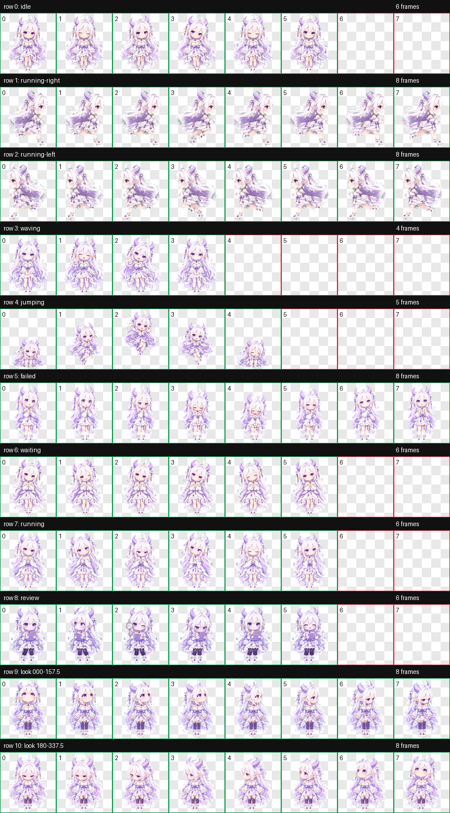

# Snowhorn GPT · Codex Pet Plugin

把白发紫角的幻想系 AI 娘 **Snowhorn GPT** 添加到 Codex。她拥有淡紫双角、精灵耳、紫色眼睛和白紫礼裙；v2 动画图集包含九类标准动画与十六个顺时针注视方向。



## 通过 Codex 插件安装

```powershell
codex plugin marketplace add Gnt191612/snowhorn-gpt
```

然后在 Codex 的插件页面安装 **Snowhorn GPT**，开启新任务并输入：

```text
安装 Snowhorn GPT
```

## 克隆后直接安装

Windows PowerShell：

```powershell
git clone https://github.com/Gnt191612/snowhorn-gpt.git
cd snowhorn-gpt
powershell -ExecutionPolicy Bypass -File .\skills\install-snowhorn-gpt\scripts\install.ps1
```

macOS / Linux：

```bash
git clone https://github.com/Gnt191612/snowhorn-gpt.git
cd snowhorn-gpt
sh ./skills/install-snowhorn-gpt/scripts/install.sh
```

安装器不会静默覆盖不同版本。需要替换时，Windows 添加 `-Force`，macOS/Linux 添加 `--force`。安装后刷新 Codex，在宠物选择器中选择 “Snowhorn GPT”。

## 规格

- `spriteVersionNumber: 2`
- RGBA WebP，1536×2288
- 8×11 单元格，每格 192×208
- 动作：待机、左右奔跑、挥手、跳跃、失败、等待、工作中、审阅
- 注视：16 个顺时针方向

## 创作灵感与搜索关键词

Snowhorn GPT 是一位白发、淡紫双角、精灵耳和紫色眼睛的 Q 版二次元 AI 娘桌宠，灵感来自用户提供的 ChatGPT 主题角色参考，并重新设计为 Codex v2 动态宠物。

相关关键词：ChatGPT inspired、GPT girl、AI娘、二次元 AI 娘、白发动漫女孩、紫角娘、精灵耳、Q版角色、chibi anime girl、anime mascot、Codex plugin、Codex pet、animated desktop pet、virtual pet、AI companion、sprite sheet。

## 声明

这是根据用户提供的 AI 角色合集图片重新设计的非官方社区作品，与 OpenAI 或 ChatGPT 官方无隶属、授权或背书关系。发布前请确认你拥有原始参考图及衍生资源所需的分发权利。

代码、文档与本仓库中的宠物资源按 [MIT License](LICENSE) 发布。

## English

Snowhorn GPT is an unofficial chibi anime AI companion pet for Codex. She features snowy-white hair, pale-lavender horns, pointed elf ears, violet eyes, and a white-and-lavender fantasy dress. The validated v2 sprite sheet includes nine standard animation states and sixteen clockwise look directions. This community project is not affiliated with or endorsed by OpenAI or ChatGPT.
